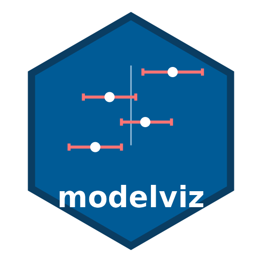
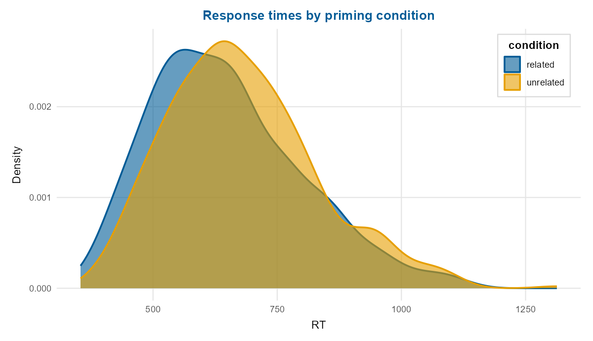
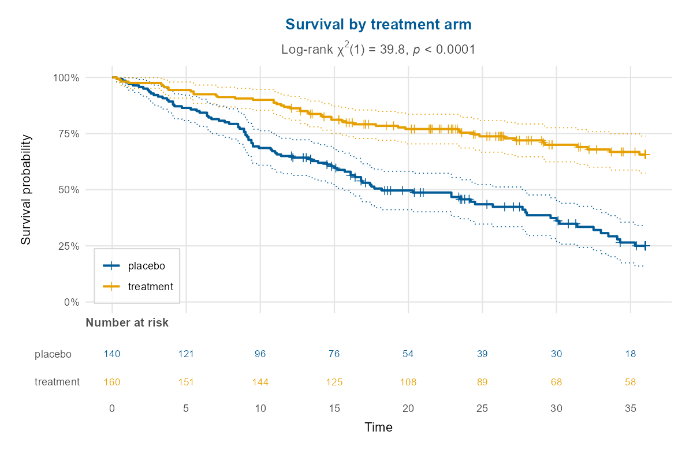

# depictr <small>(R)</small> 

<!-- badges: start -->
[](https://CRAN.R-project.org/package=depictr)
[](https://github.com/pablobernabeu/depictr/actions/workflows/R-CMD-check.yaml)
[](https://lifecycle.r-lib.org/articles/stages.html#experimental)
[](https://opensource.org/license/MIT)
[](https://doi.org/10.32614/CRAN.package.depictr)
<!-- badges: end -->

depictr is a toolkit of publication-ready plots for the analysis workflow, from
a first look at the data, through model estimates and predictions, to
diagnostics, uncertainty and reporting. Most packages address one part of this
work. depictr aims to cover all of it with one theme, one palette and one set of
label conventions. Every plotting function returns a
[ggplot2](https://ggplot2.tidyverse.org) object, or a
[patchwork](https://patchwork.data-imaginist.com) object for composite panels,
and the result can be refined further with the usual `+` syntax.

This is the R sibling of [the Python
package](https://pablobernabeu.github.io/depictr-py/) of the same name, which
covers most of the same workflow and is built on [plotnine](https://plotnine.org).
The Python package's README lists the few functions that have yet to be ported
and the differences that change what a figure shows. Many of those differences
are arguments the Python functions do not yet take.

## Gallery

The figures below, each from a single function call, show a grouped density in
the default palette and Kaplan-Meier survival curves with confidence bands and a
number-at-risk table.





## Installation

depictr is on [CRAN](https://CRAN.R-project.org/package=depictr):

```r
install.packages("depictr")
```

The heavier modelling back-ends, `lme4`, `broom` and `simr`, are optional. They
are listed in `Suggests` and used only when installed. The core functions,
examples, tests and vignettes run on base `lm`/`glm` and the bundled data alone.

The development version can be installed from GitHub:

```r
# install.packages("remotes")
remotes::install_github("pablobernabeu/depictr")
```

## Function families

The functions fall into seven families that follow the analysis workflow.
Exploratory plots and a descriptive summary table come first. The model-estimate
plots follow (forest plots, model comparison, predictions, interactions and
random effects), then residual diagnostics with the standard classification
curves, and then posterior summaries and power curves. Further families cover
principal components, clustering and survival, time series, and the shared theme
with the accessibility checks, composition, saving and reporting helpers. The
[reference](https://pablobernabeu.github.io/depictr/reference/index.html) lists
every function by family.

## Measured accessibility

The default palette is based on the Okabe-Ito set. To test that choice, the
package provides a simulator of colour-vision deficiency based on the model of
Machado, Oliveira and Fernandes (2009), and `palette_safety()` measures how far
apart the palette's colours stay under each deficiency.

`check_figure()` audits the plot you are about to submit, which the palette's
guarantee does not cover. It measures the separability of the encoding
colours under each dichromacy and in greyscale, the smallest text size at the
printed width, the WCAG contrast of text and geometry against their
backgrounds, and whether any distinction rests on colour alone. The size check
covers the text drawn inside the panel and around it, and the contrast check
covers only the text around it. Each row of the result reports the measured
value next to its threshold. For a figure saved at its final width, give that
width as both `width_cm` and `render_width_cm`, leave both at their defaults
or let `save_plot(check = TRUE)` audit the figure at the width it saves. For a
journal that caps text size, as Nature does at 7 pt, pass the cap as
`max_text_pt`.

```r
check_figure(explore_distribution(lexical_decision, RT, group = condition),
             width_cm = 8.9)
```

The audit does not check continuous colour scales, and the colour rows of a
heatmap state this. For continuous scales, prefer a perceptually ordered map
such as viridis or the package's sequential and diverging ramps.

The colourblind-safety guarantee covers the eight built-in colours. For more
than eight groups, the palette interpolates, with a warning from
`depictr_palette()`. The guarantee also covers only hue confusion. In
greyscale, the palette's orange and sky blue differ by only 0.79 in CIE
lightness, so they print as the same grey. A figure that may be printed in
black and white should use fewer groups, a sequential palette, or a redundant
shape or line type.

The palette also falls short on contrast. Four of the eight colours fall below
the 3:1 contrast against white that WCAG asks of a graphical object. The orange
is one of them. As the second colour, it appears in every default figure that
colours two or more groups. The example above therefore fails
`geometry_contrast`, as well as `redundant_encoding` and, at 8.9 cm,
`text_size`. With opaque marks, the vermillion `#d55e00` in the orange's place
and a redundant shape or line type, the figure passes `geometry_contrast` and
`redundant_encoding`. `scale_colour_depictr(order = "contrast")` makes that
substitution for one plot, and
`depictr_options(palette = depictr_palette(order = "contrast"))` does so for
every plot made afterwards.

## A first plot

```r
library(depictr)

fit <- lm(yield ~ rainfall + fertiliser + soil_ph + treatment, data = crop_yield)
coefficient_plot(fit, order = "descending")
```

The [Get started](https://pablobernabeu.github.io/depictr/articles/depictr.html)
article covers the whole workflow, from exploration to diagnostics and
reporting.

## Bundled data

The package includes five reproducibly simulated datasets (`lexical_decision`,
`wellbeing_survey`, `crop_yield`, `clinical_trial` and `monthly_sales`), which
are used in every example and vignette. Each is documented under its own name
and described in the [Get started](https://pablobernabeu.github.io/depictr/articles/depictr.html)
article. All five are generated with fixed seeds by
[`data-raw/generate_datasets.R`](https://github.com/pablobernabeu/depictr/blob/main/data-raw/generate_datasets.R).

## Learn more

Each vignette works through one part of the workflow on the bundled data.

* `vignette("depictr")`: getting started
* `vignette("exploring-data")`: exploratory plots, estimation statistics and tables
* `vignette("model-estimates")`: estimates, comparison, predictions, random effects and Bayesian posteriors
* `vignette("diagnostics-and-uncertainty")`: diagnostics, classification, posteriors, power
* `vignette("multivariate-and-survival")`: PCA, clustering with diagnostics, survival curves
* `vignette("time-series")`: trends, autocorrelation, decomposition, seasonality and forecasts

## How depictr relates to other packages

depictr aims for breadth and consistency across the workflow and complements
the specialised packages. For a deeper treatment of any one area, several of
those remain the better choice, among them
[`ggstatsplot`](https://www.indrapatil.com/ggstatsplot/) (statistical
details on plots), [`sjPlot`](https://strengejacke.github.io/sjPlot/) and the
[easystats](https://easystats.github.io/easystats/) family (`see`, `parameters`,
`performance`), [`marginaleffects`](https://marginaleffects.com) /
[`ggeffects`](https://strengejacke.github.io/ggeffects/) (predictions),
[`GGally`](https://ggobi.github.io/ggally/) (pairs),
[`factoextra`](https://rpkgs.datanovia.com/factoextra/) (PCA and clustering),
[`survminer`](https://rpkgs.datanovia.com/survminer/) (survival),
[`feasts`](https://feasts.tidyverts.org) / `ggfortify` (time series),
[`ggdist`](https://mjskay.github.io/ggdist/) / `dabestr` (distributions and
estimation) and [`bayesplot`](https://mc-stan.org/bayesplot/) / `tidybayes`
(Bayesian).

## Automated maintenance

Because depictr depends on a number of plotting and modelling packages,
scheduled GitHub Actions check it between releases. A daily job checks the
package and its full test suite against the current and the development
versions of its dependencies, and a weekly job checks every URL in the
documentation. In addition, `R CMD check` runs on Linux, macOS and Windows on
every push to `main` and on every pull request into it.

## Citation

`citation("depictr")` gives the preferred reference. CRAN assigned the package
the DOI <https://doi.org/10.32614/CRAN.package.depictr>, which covers every
version. The [About
page](https://pablobernabeu.github.io/depictr/articles/about.html) shows the
same citation with a BibTeX entry and a short note on the developer, and the
repository includes
[`CITATION.cff`](https://github.com/pablobernabeu/depictr/blob/main/CITATION.cff)
for the *Cite this repository* button on GitHub.

The relevant help pages and vignettes cite the methods the package implements,
drawing on a single bibliography at [`inst/REFERENCES.bib`](https://github.com/pablobernabeu/depictr/blob/main/inst/REFERENCES.bib).

## Licence

MIT (c) Pablo Bernabeu. See the
[licence](https://github.com/pablobernabeu/depictr/blob/main/LICENSE.md).

## Contributing

Issues and pull requests are welcome. The [contributing
guide](https://github.com/pablobernabeu/depictr/blob/main/.github/CONTRIBUTING.md)
describes the development setup and the conventions the package follows.
Everyone taking part is asked to honour the [Code of
Conduct](https://github.com/pablobernabeu/depictr/blob/main/.github/CODE_OF_CONDUCT.md).
