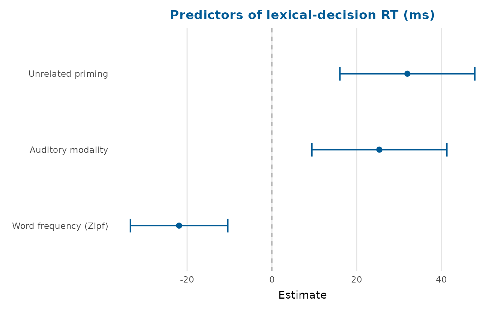
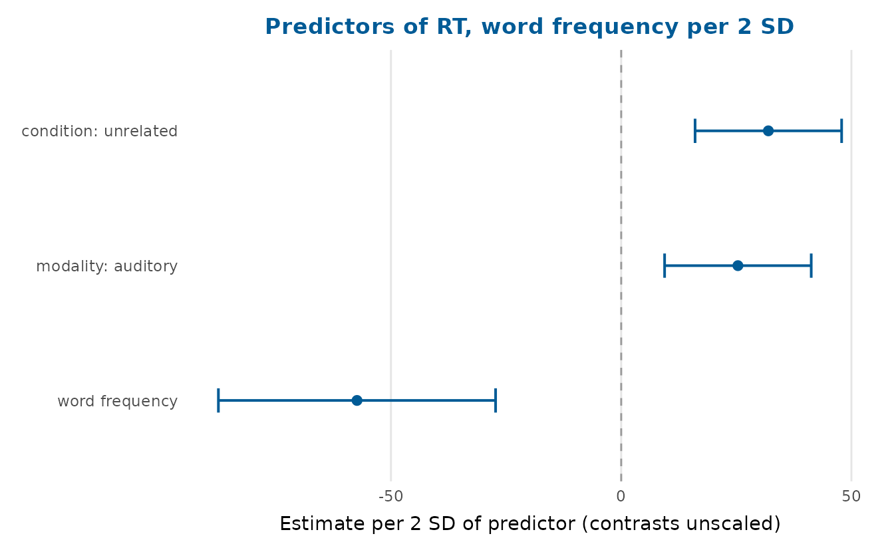
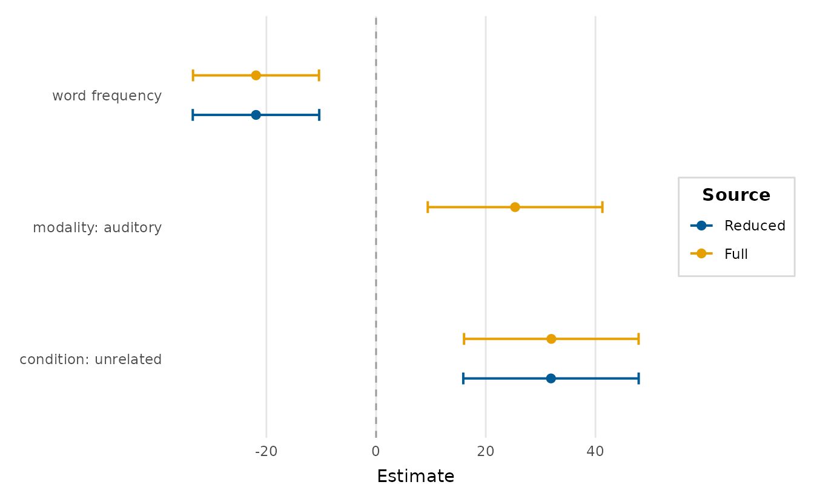
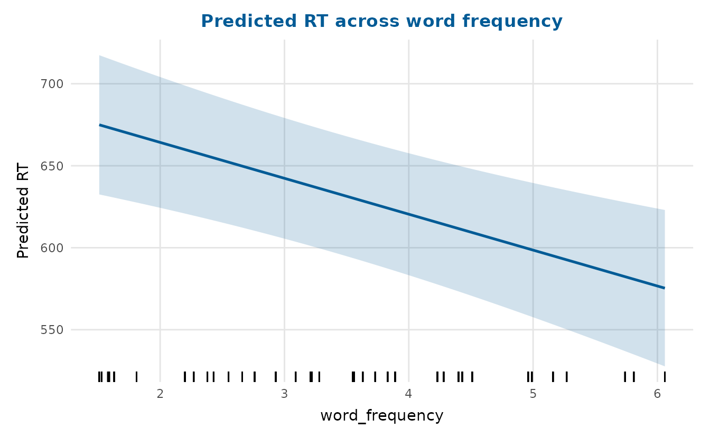
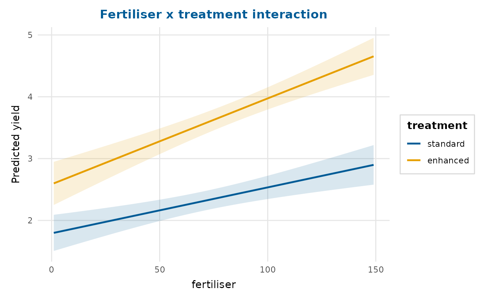
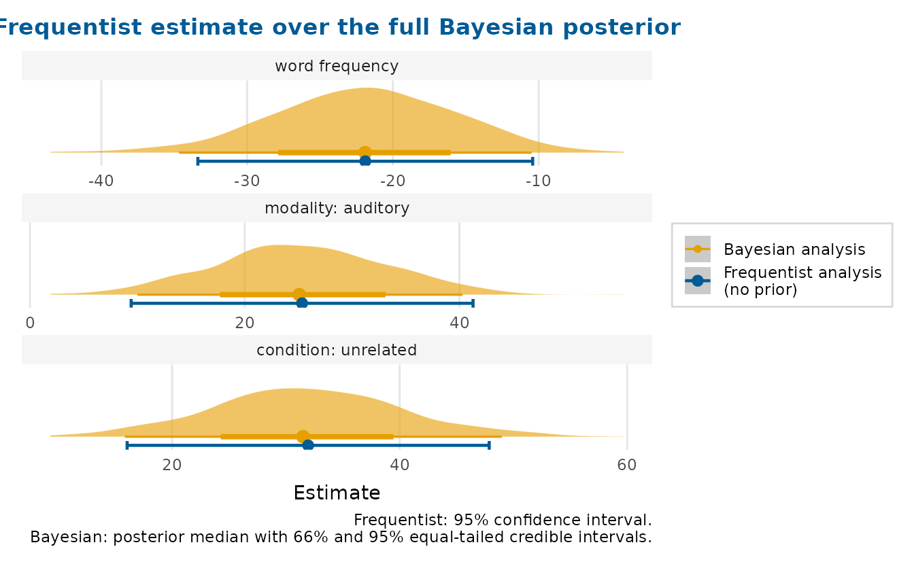
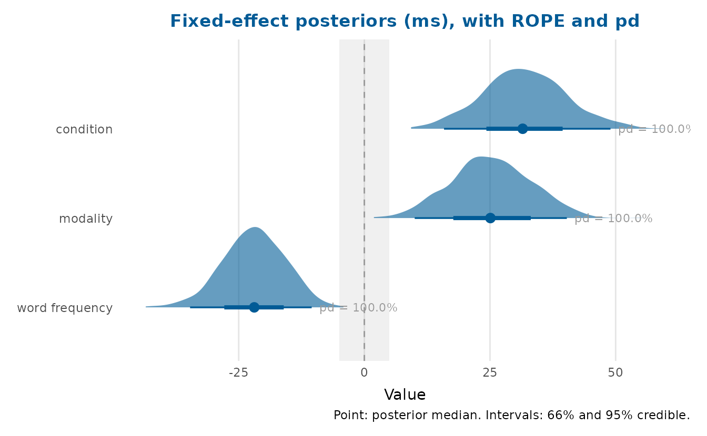
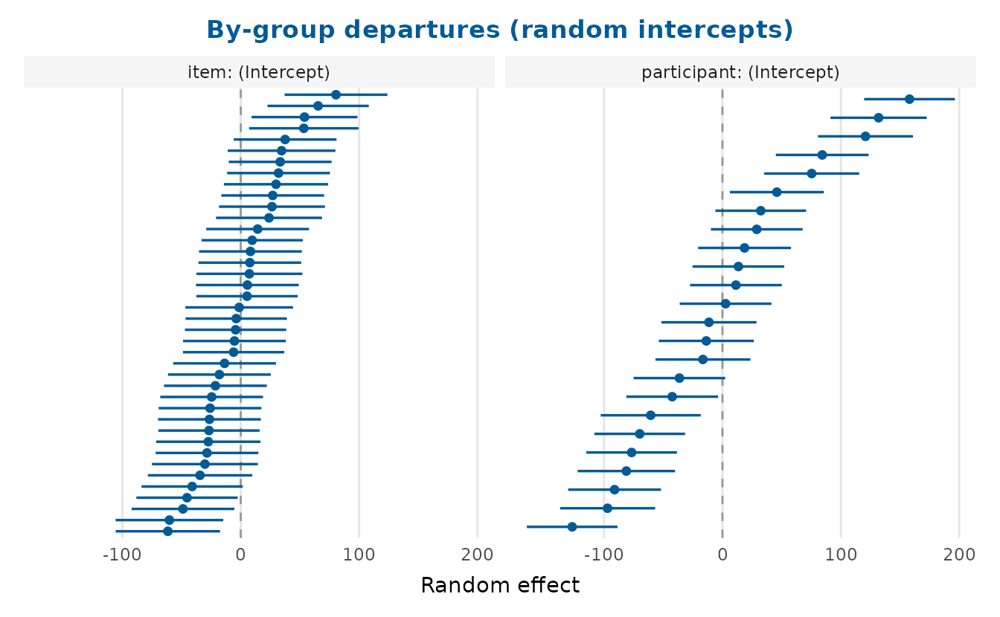
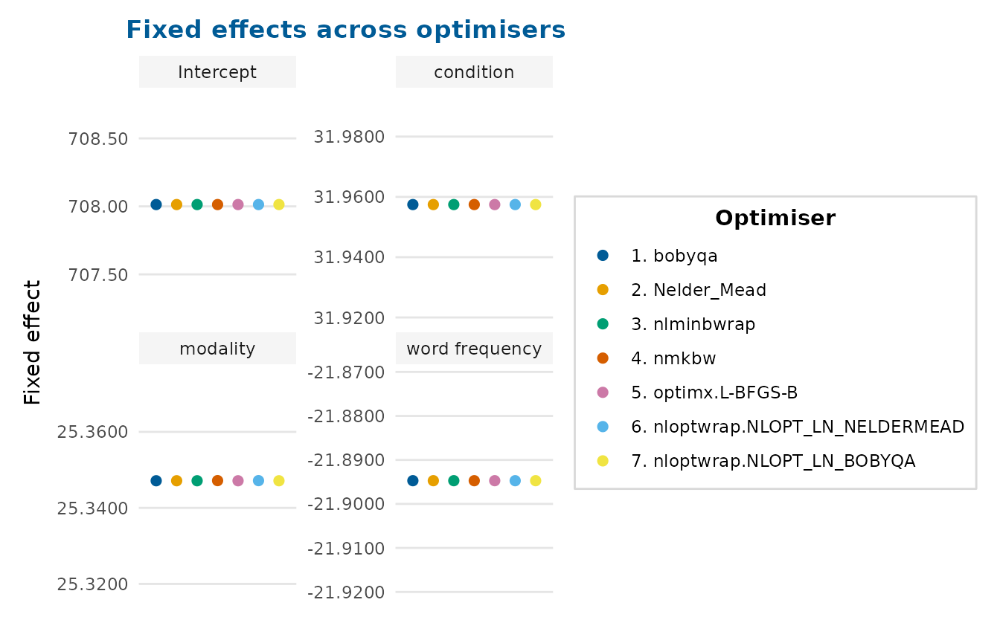
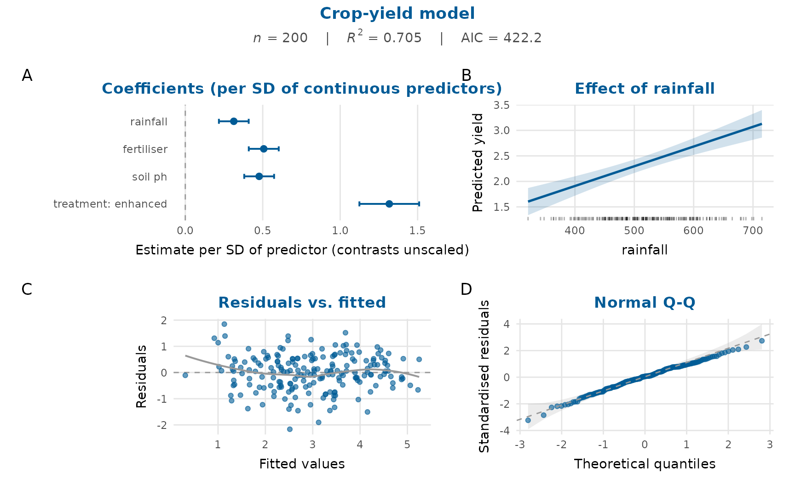

# Visualising model estimates

This article works through depictr’s model-result plots (coefficients,
model comparison, predicted values, interactions, random effects and
goodness-of-fit). It also covers
[`frequentist_bayesian_plot()`](https://pablobernabeu.github.io/depictr/reference/frequentist_bayesian_plot.md),
which shows a frequentist estimate and the Bayesian posterior
distribution for the same model on one figure.

The running example is `lexical_decision`, a crossed lexical-decision
experiment (24 participants, 40 items, 960 trials). We model reaction
time on correct trials as a function of priming `condition`
(related/unrelated), presentation `modality` (visual/auditory) and item
`word_frequency`, with crossed random intercepts for participant and
item. Because the design is counterbalanced, neither fixed factor is
collinear with the item random effect.

``` r

correct <- subset(lexical_decision, accuracy == 1)
fit <- lmerTest::lmer(
  RT ~ condition + modality + word_frequency +
    (1 | participant) + (1 | item),
  data = correct
)
```

## Coefficient (forest) plots

[`coefficient_plot()`](https://pablobernabeu.github.io/depictr/reference/coefficient_plot.md)
reads the fitted mixed model through
[`tidy_estimates()`](https://pablobernabeu.github.io/depictr/reference/tidy_estimates.md)
and draws a horizontal point-and-interval (‘forest’) plot. Unrelated
primes and auditory presentation both slow responses, while more
frequent words speed them up.

``` r

coefficient_plot(
  fit, order = "ascending",
  labels = c(conditionunrelated = "Unrelated priming",
             modalityauditory = "Auditory modality",
             word_frequency = "Word frequency (Zipf)"),
  title = "Predictors of lexical-decision RT (ms)"
)
```



Coefficient names are tidied automatically. `word_frequency` becomes
`word frequency`, and a factor’s coefficient is labelled with its
variable and the level compared with the reference, so
`conditionunrelated` becomes `condition: unrelated`. Pass `labels` to
override any of them.

A slope per Zipf unit and a contrast between two conditions are in
different units. `standardise = TRUE` multiplies the slope of each
continuous predictor by that predictor’s standard deviation, so the
word-frequency slope reads as the change in RT per SD. The two factor
contrasts stay as differences in milliseconds between conditions. A
contrast already compares two groups, and its per-SD value would depend
on how evenly the trials happen to be split between them ([Gelman,
2008](#ref-gelman2008)). An interaction is scaled through its inputs in
the same way. Gelman recommends two SDs, which makes a continuous slope
roughly comparable with a binary contrast. `sd_multiple = 2` follows
that convention, and the axis label names whichever convention is used:

``` r

coefficient_plot(fit, standardise = TRUE, sd_multiple = 2, order = "ascending",
                 title = "Predictors of RT, word frequency per 2 SD")
```



To keep the raw units instead, including a large intercept that would
otherwise compress the slopes, set `facet = TRUE`, which gives each term
its own free-scaled panel.
[`frequentist_bayesian_plot()`](https://pablobernabeu.github.io/depictr/reference/frequentist_bayesian_plot.md),
shown below, uses this layout by default.

## Comparing models

[`compare_models()`](https://pablobernabeu.github.io/depictr/reference/compare_models.md)
overlays the estimates from several models so you can see how a
coefficient moves as the specification changes. Here a reduced model
without `modality` is compared with the full model, and
[`model_fit_table()`](https://pablobernabeu.github.io/depictr/reference/model_fit_table.md)
summarises their fit.

``` r

reduced <- lmerTest::lmer(
  RT ~ condition + word_frequency + (1 | participant) + (1 | item),
  data = correct
)
compare_models(Reduced = reduced, Full = fit, order = "descending")
```



``` r

knitr::kable(model_fit_table(Reduced = reduced, Full = fit))
```

    model_fit_table(): REML fits were refitted by maximum likelihood for AIC, BIC and logLik, so models that differ in their fixed effects can be compared.

| model   |   n |  df |      AIC |      BIC |    logLik |  R2 |    RMSE |
|:--------|----:|----:|---------:|---------:|----------:|----:|--------:|
| Reduced | 902 |   6 | 11357.00 | 11385.83 | -5672.502 |  NA | 118.790 |
| Full    | 902 |   7 | 11349.29 | 11382.92 | -5667.643 |  NA | 118.129 |

Both models were fitted by restricted maximum likelihood (REML), the
default of `lmer()`. A REML likelihood is the likelihood of the
residuals left once the fixed effects are removed. It changes with the
fixed effects, so REML criteria cannot compare models that differ in
them, as these two do.
[`model_fit_table()`](https://pablobernabeu.github.io/depictr/reference/model_fit_table.md)
therefore takes AIC, BIC and the log-likelihood from a
maximum-likelihood refit, as
[`anova()`](https://rdrr.io/r/stats/anova.html) does for lme4 fits, and
says so in a message.

The `R2` column reads `NA` for mixed models, since no single R-squared
is standard for them. For a `glm`, the column reports the deviance
R-squared ([Cameron & Windmeijer, 1997](#ref-cameron1997)), the share of
the null deviance that the predictors explain. That equals the ordinary
R-squared for a Gaussian model with the identity link and McFadden’s
pseudo-R-squared ([McFadden, 1974](#ref-mcfadden1974)) for binary
logistic regression.

## Predicted values and interactions

[`effects_plot()`](https://pablobernabeu.github.io/depictr/reference/effects_plot.md)
shows what the model predicts as one predictor varies, holding the
others at typical values. It also works on the mixed model, where its
predictions use the fixed effects only (`re.form = NA`) and the band is
built from the fixed-effect design matrix and
[`vcov()`](https://rdrr.io/r/stats/vcov.html).

``` r

effects_plot(fit, "word_frequency",
             title = "Predicted RT across word frequency")
```



[`interaction_plot()`](https://pablobernabeu.github.io/depictr/reference/interaction_plot.md)
shows how a relationship changes across a second predictor. The
lexical-decision model is additive, so we switch to `crop_yield`, whose
data-generating process contains a fertiliser-by-treatment interaction.
Fertiliser raises yield far more under the `enhanced` treatment than
under `standard`, so the slopes diverge.

``` r

crop_fit <- lm(yield ~ fertiliser * treatment + rainfall, data = crop_yield)
interaction_plot(crop_fit, "fertiliser", "treatment",
                 title = "Fertiliser x treatment interaction")
```



## Frequentist and Bayesian estimates together

Given the frequentist fit and a set of Bayesian posterior draws,
[`frequentist_bayesian_plot()`](https://pablobernabeu.github.io/depictr/reference/frequentist_bayesian_plot.md)
shows the posterior distribution of each term as a ‘ggdist’ half-eye and
overlays the frequentist point and confidence interval at the same
position. The two sources take the first two colours of the
colourblind-safe palette.

The draws here are the fixed-effect posterior from a `brms` fit of the
same model (1000 draws x 4 parameters). They are stored in the package
so that the slow MCMC need not be re-run. Terms are matched by canonical
label, so the `brms` parameter names line up with the frequentist ones
automatically.

``` r

draws <- readRDS(
  system.file("extdata", "lexdec_draws.rds", package = "depictr")
)

frequentist_bayesian_plot(
  fit, draws,
  intercept = FALSE,
  note_frequentist_no_prior = TRUE,
  title = "Frequentist estimate over the full Bayesian posterior"
)
```



The frequentist confidence interval and the bulk of the Bayesian
posterior fall in the same place, but only the posterior shows the
density, the skew and the mass on either side of zero.

If `ggdist` is unavailable, the function falls back to a
point-and-interval forest plot of the two sources. When the Bayesian
side is supplied as a *summary* table instead of draws, for instance the
`Estimate`, `Q2.5` and `Q97.5` of `brms::fixef()`, it draws the familiar
two-source forest plot.

## Posterior distributions on their own

[`posterior_plot()`](https://pablobernabeu.github.io/depictr/reference/posterior_plot.md)
summarises any draws (posterior, bootstrap or simulation) as a
distribution per parameter. With `style = "halfeye"`, it shows the
density slab and a point-and-interval. A region of practical equivalence
(ROPE) can be shaded, and each parameter can be annotated with its
probability of direction, the posterior mass on its majority side of the
reference line.

``` r

draws <- readRDS(
  system.file("extdata", "lexdec_draws.rds", package = "depictr")
)
slopes <- draws[c("conditionunrelated", "modalityauditory", "word_frequency")]

posterior_plot(
  slopes, style = "halfeye", rope = c(-5, 5), pd = TRUE,
  labels = c(conditionunrelated = "condition",
             modalityauditory = "modality",
             word_frequency = "word frequency"),
  title = "Fixed-effect posteriors (ms), with ROPE and pd"
)
```



The posteriors of `word_frequency` and `conditionunrelated` lie almost
entirely on one side of zero, so their probability of direction is
effectively 100%.

## Random effects

[`random_effects_plot()`](https://pablobernabeu.github.io/depictr/reference/random_effects_plot.md)
reads the fitted model and draws a caterpillar plot of the conditional
modes (‘BLUPs’). It shows the by-item and by-participant departures from
the average, sorted and with their uncertainty, which is the usual way
to spot unusual groups.

``` r

random_effects_plot(fit, title = "By-group departures (random intercepts)")
```



## Optimiser checks

A mixed-model fit should be stable across optimisers.
[`lme4::allFit()`](https://rdrr.io/pkg/lme4/man/allFit.html) refits the
model with every available optimiser, and
[`optimizer_fixef_plot()`](https://pablobernabeu.github.io/depictr/reference/optimizer_fixef_plot.md)
then shows the fixed effects side by side, one panel per term. Tight
clusters mean that the fit is stable, and scattered points would signal
a fragile solution.

The package includes the `allFit()` summary for this model, so we can
plot it without re-running the slow refits. The plot accepts a tidy data
frame of optimiser-by-term values, which we take from the stored
summary.

``` r

af <- readRDS(system.file("extdata", "allfit_lexdec.rds", package = "depictr"))
fx <- af$fixef    # optimisers x fixed effects
opt_long <- data.frame(
  optimizer = rep(rownames(fx), times = ncol(fx)),
  term      = rep(colnames(fx), each = nrow(fx)),
  value     = as.vector(fx)
)

optimizer_fixef_plot(
  opt_long, title = "Fixed effects across optimisers",
  labels = c(conditionunrelated = "condition",
             modalityauditory = "modality",
             word_frequency = "word frequency")
)
```



The points coincide within each panel, so every optimiser reaches the
same estimate for each term and this fit is stable.

## A one-figure model report

[`model_report()`](https://pablobernabeu.github.io/depictr/reference/model_report.md)
composes the coefficients, the effect of a focal predictor, residuals
against fitted values and a Q-Q plot into a single figure, with a
subtitle of fit statistics, for a quick review or a report appendix. It
works on `lm` and `glm` models, and a `glm` gets the binned-residual and
quantile-residual panels of
[`residual_diagnostics_plot()`](https://pablobernabeu.github.io/depictr/reference/residual_diagnostics_plot.md).
Here we use the crop-yield model.

``` r

full <- lm(yield ~ rainfall + fertiliser + soil_ph + treatment,
           data = crop_yield)
model_report(full, title = "Crop-yield model")
```



## References

Cameron, A. C., & Windmeijer, F. A. G. (1997). An R-squared measure of
goodness of fit for some common nonlinear regression models. *Journal of
Econometrics*, *77*(2), 329–342.
<https://doi.org/10.1016/S0304-4076(96)01818-0>

Gelman, A. (2008). Scaling regression inputs by dividing by two standard
deviations. *Statistics in Medicine*, *27*(15), 2865–2873.
<https://doi.org/10.1002/sim.3107>

McFadden, D. (1974). Conditional logit analysis of qualitative choice
behavior. In P. Zarembka (Ed.), *Frontiers in econometrics* (pp.
105–142). Academic Press.
