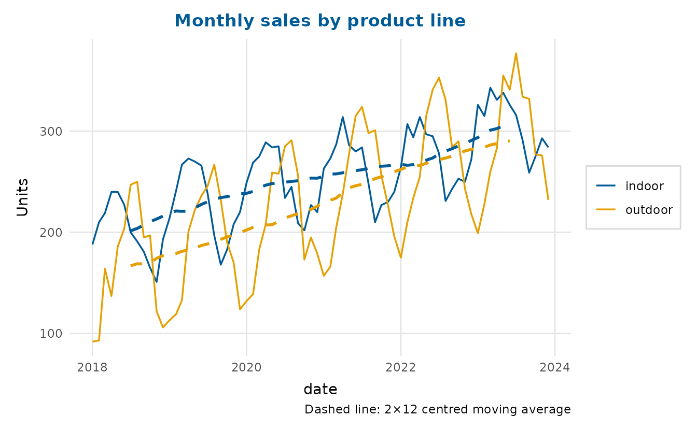
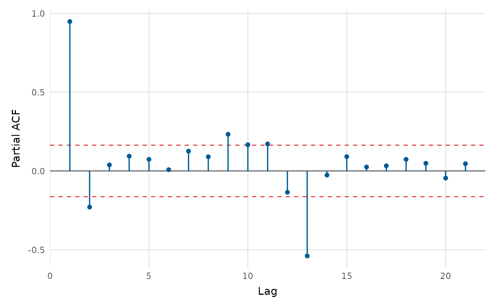
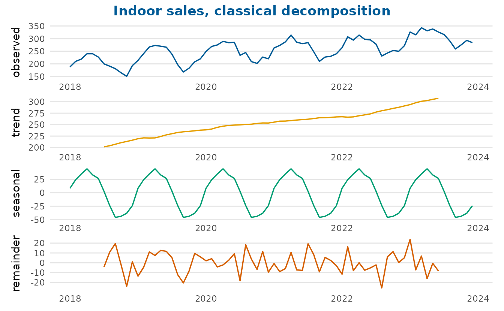
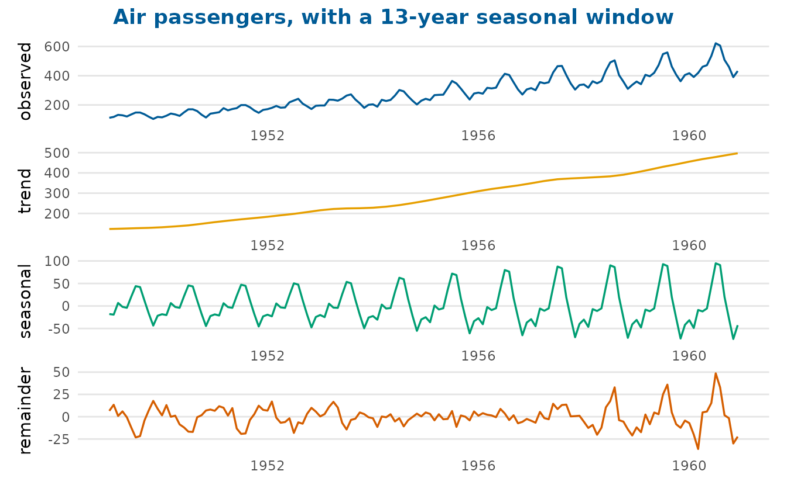
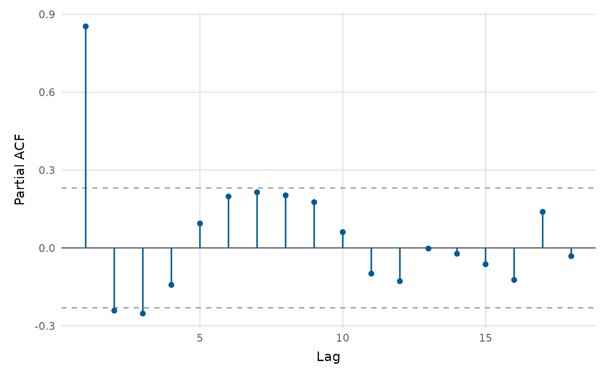
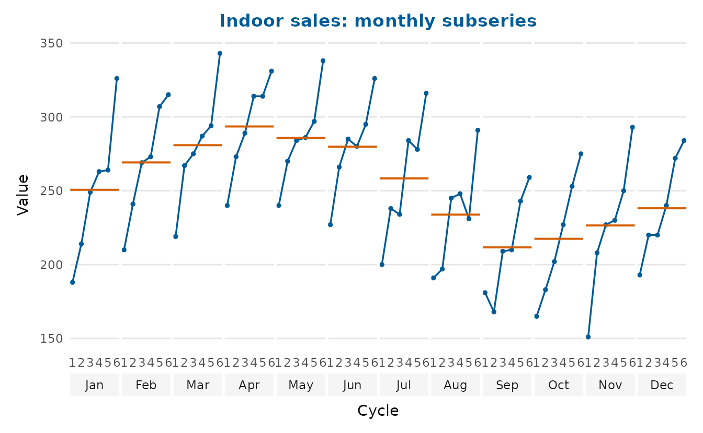
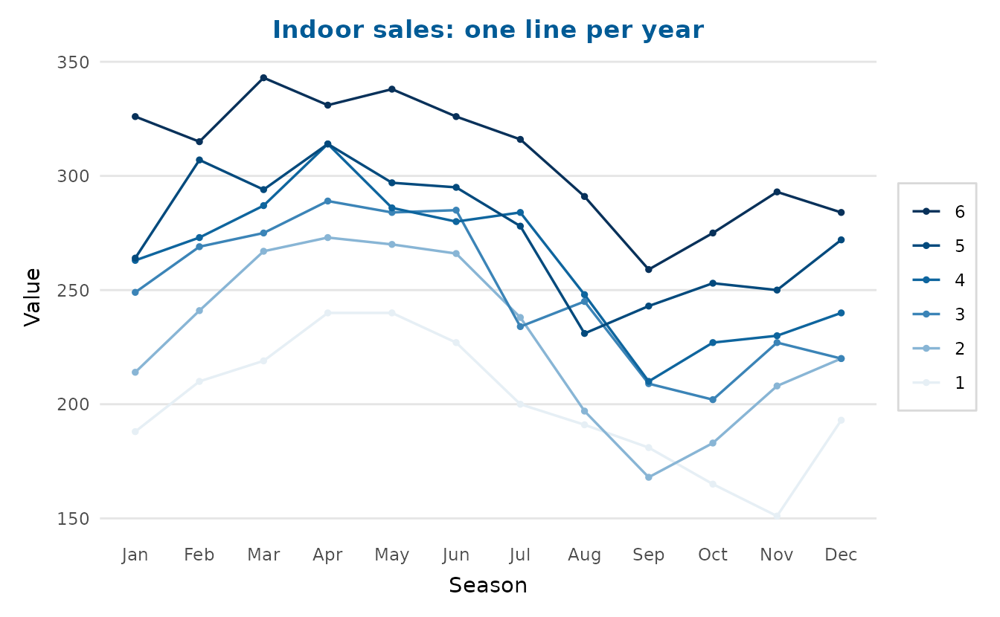
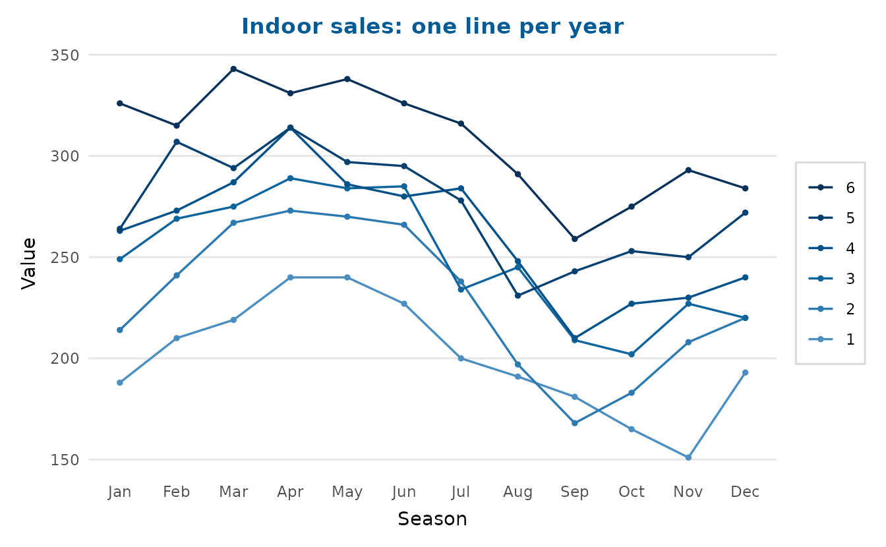
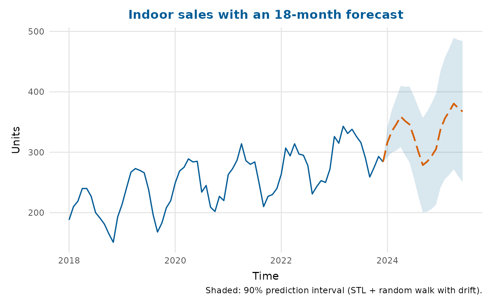
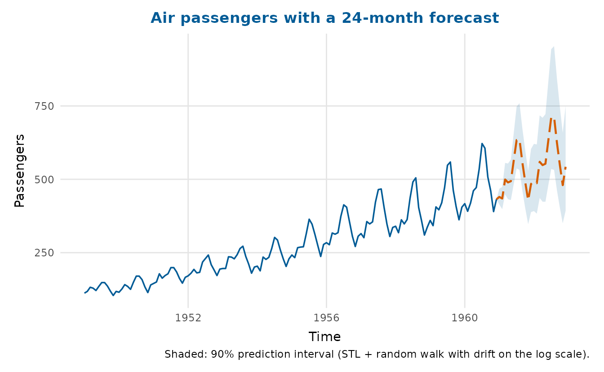

# Time series

depictr provides a small, consistent set of time-series plots. The
examples use the bundled `monthly_sales` dataset: two product lines
(`indoor` and `outdoor`), each with six years of monthly observations
carrying a trend, a twelve-month seasonal cycle and noise.

## Plotting one or several series

[`timeseries_plot()`](https://pablobernabeu.github.io/depictr/reference/timeseries_plot.md)
accepts a `ts` object, a numeric vector or a data frame with time, value
and (optionally) group columns. Passing the long-form data frame with a
grouping column draws both series at once, each in its own colour, and a
moving-average overlay is one argument away.

``` r

timeseries_plot(monthly_sales, time = date, value = sales, group = series,
                rolling = 12, title = "Monthly sales by product line",
                y_lab = "Units")
```



For the single-series views (decomposition, autocorrelation, the
seasonal plot and forecasting) we extract one line as a monthly `ts`
object of frequency 12.

``` r

indoor <- subset(monthly_sales, series == "indoor")
indoor <- indoor[order(indoor$date), ]
indoor_ts <- ts(indoor$sales, start = c(2018, 1), frequency = 12)
```

## Decomposition

[`decompose_plot()`](https://pablobernabeu.github.io/depictr/reference/decompose_plot.md)
separates a seasonal series into trend, seasonal and remainder
components. Use `method = "stl"` (the default, loess-based) or
`method = "classical"`. Setting `confidence = TRUE` shades a band around
the smoothed trend, from the spread of the remainder, so the scale of
the unexplained variation is visible rather than implied by the line
alone.

``` r

decompose_plot(indoor_ts, confidence = TRUE, title = "Indoor sales, decomposed")
```



Classical decomposition holds the seasonal component fixed across the
whole series, and so does STL ([Cleveland et al.,
1990](#ref-cleveland1990)) with its default `s_window = "periodic"`.

``` r

decompose_plot(indoor_ts, method = "classical",
               title = "Indoor sales, classical decomposition")
```



A numeric `s_window` lets the STL seasonal component change from year to
year. It is the number of consecutive years used to estimate each
seasonal value, an odd number of at least 7, so a smaller window lets
the pattern change faster. The bundled series has a fixed seasonal
pattern by construction, so the effect shows better on `AirPassengers`,
whose seasonal swing grows with the number of passengers.

``` r

decompose_plot(AirPassengers, s_window = 13,
               title = "Air passengers, with a 13-year seasonal window")
```



## Autocorrelation

[`acf_plot()`](https://pablobernabeu.github.io/depictr/reference/acf_plot.md)
draws the autocorrelation (or, with `type = "partial"`, the partial
autocorrelation) function, with approximate significance bounds. The
spikes at multiples of twelve are the annual seasonality.

``` r

acf_plot(indoor_ts)
```



``` r

acf_plot(indoor_ts, type = "partial")
```



## The seasonal pattern up close

[`seasonal_plot()`](https://pablobernabeu.github.io/depictr/reference/seasonal_plot.md)
draws a seasonal-subseries (cycle) plot: one small panel per month, with
the value traced across successive years and a reference line at each
month’s mean. This shows the seasonal shape (differences *between*
panels) and the year-on-year trend within each month (the slope *inside*
each panel) at the same time, something a single overlaid line cannot
do.

``` r

seasonal_plot(indoor_ts, title = "Indoor sales: monthly subseries")
```



With `style = "season"` every year becomes its own line over the months
on a shared axis, which is handy for spotting an unusual year.

``` r

seasonal_plot(indoor_ts, style = "season",
              title = "Indoor sales: one line per year")
```



## Forecasting

[`ts_forecast()`](https://pablobernabeu.github.io/depictr/reference/ts_forecast.md)
forecasts by decomposition ([Hyndman & Athanasopoulos, 2021, Section
5.7](#ref-hyndman2021)). It removes the seasonal component that STL
estimates, forecasts what remains with a random walk with drift and adds
the last year’s seasonal pattern back. Its prediction intervals are
those of the random walk with drift, which widen with the horizon
([Hyndman & Athanasopoulos, 2021, Section 5.5](#ref-hyndman2021)).

``` r

fc <- ts_forecast(indoor_ts, h = 18, level = 0.9)
head(fc)
```

          time      fit      lwr      upr
    1 2024.000 316.3669 291.6190 341.1148
    2 2024.083 334.7537 299.5126 369.9948
    3 2024.167 346.3072 302.8512 389.7631
    4 2024.250 359.1704 308.6539 409.6869
    5 2024.333 351.7003 294.8458 408.5547
    6 2024.417 346.0037 283.3144 408.6930

Passing an integer horizon straight to
[`timeseries_plot()`](https://pablobernabeu.github.io/depictr/reference/timeseries_plot.md)
overlays that forecast on the history: the point forecast continues the
line and the shaded ribbon shows the (growing) 90% prediction interval,
named in the caption.

``` r

timeseries_plot(indoor_ts, forecast = 18, level = 0.9,
                title = "Indoor sales with an 18-month forecast",
                y_lab = "Units")
```



The model assumes a seasonal pattern that adds to the level and stays
the same from year to year. Its band treats that pattern as known, which
leaves out the uncertainty in estimating it. In a rolling-origin
backtest on five classic series whose seasonal swing does not grow with
their level, the nominal 95% band covered 92% of one-step-ahead
outcomes. From three to 12 steps ahead, it covered 99%. The band
therefore runs somewhat narrow at the shortest horizons and wide further
out, where the uncertainty of a random walk keeps growing while these
series stay close to their trend. When the swing does grow with the
level, as it does for `AirPassengers`, set `lambda = 0` to forecast the
logarithm. The forecast comes back on the original scale, where the
point forecast is the median of the forecast distribution ([Hyndman &
Athanasopoulos, 2021, Section 5.6](#ref-hyndman2021)).

``` r

timeseries_plot(AirPassengers, forecast = 24, level = 0.9, lambda = 0,
                title = "Air passengers with a 24-month forecast",
                y_lab = "Passengers")
```



For a different model, fit it yourself (for example with
[`forecast::forecast()`](https://generics.r-lib.org/reference/forecast.html))
and pass the resulting `time`/`fit`/`lwr`/`upr` columns to
`timeseries_plot(forecast = )` as a data frame.

## References

Cleveland, R. B., Cleveland, W. S., McRae, J. E., & Terpenning, I.
(1990). STL: A seasonal-trend decomposition procedure based on loess.
*Journal of Official Statistics*, *6*(1), 3–73.

Hyndman, R. J., & Athanasopoulos, G. (2021). *Forecasting: Principles
and practice* (3rd ed.). OTexts. <https://otexts.com/fpp3/>
